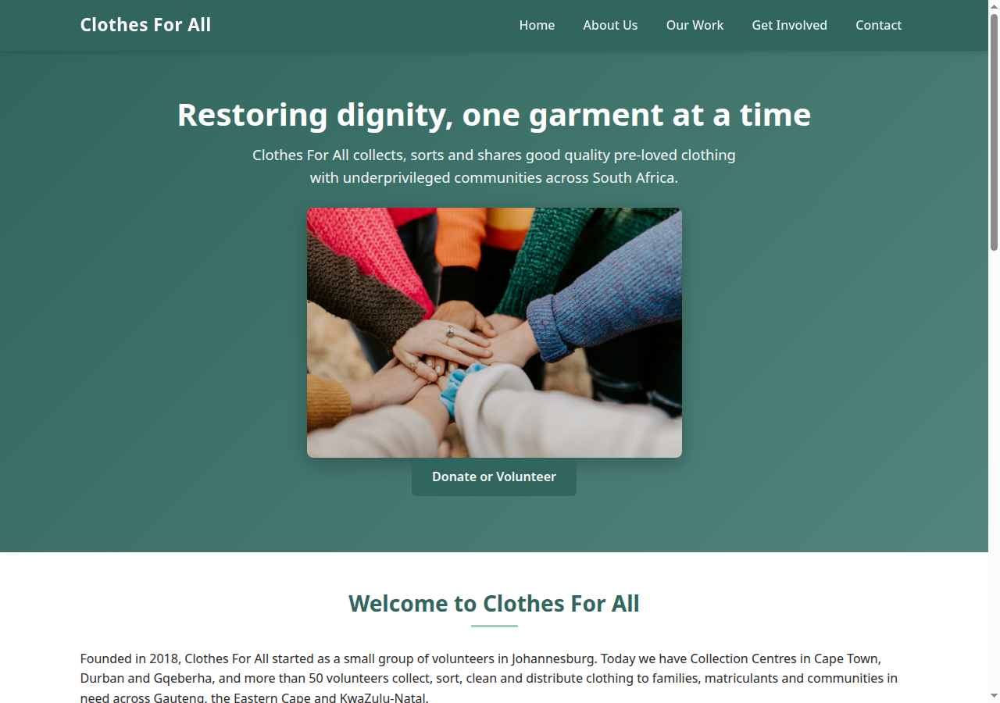
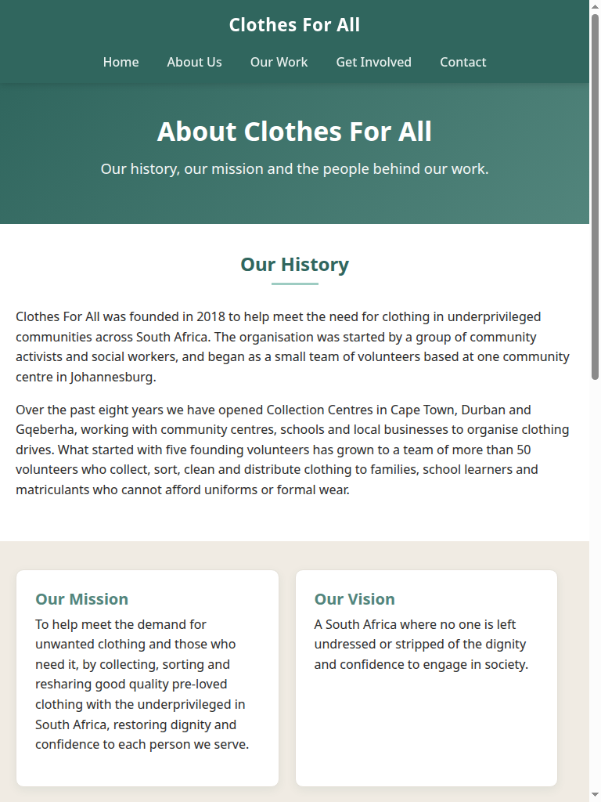
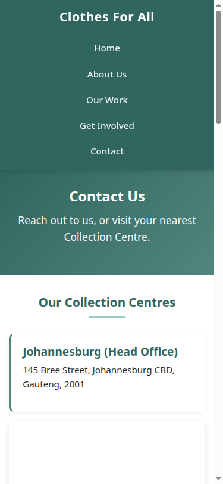
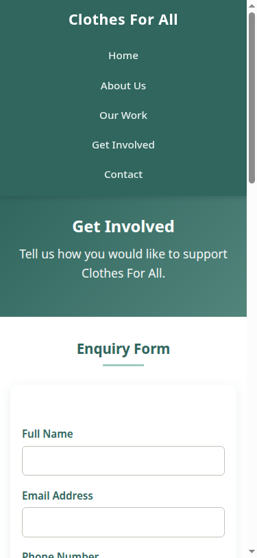

# Clothes For All (CFA)
- **Developer**: Neo Ntwampe
- **Student Number**: ST10516094
- **Group**: 1
- **Course**: WEDE5020
- **Subject**: Web Development

## Links
- GitHub Repository: https://github.com/EMGPSD/wede5020-2026-part-3-neontwampe06-prog

---

## Project Overview
This project is a five-page website for Clothes For All, a South African non-profit organisation that collects and redistributes good-quality pre-loved clothing. The organisation started in 2018 and has collection centres in Johannesburg, Cape Town, Durban and Gqeberha, serving communities in Gauteng, the Eastern Cape and KwaZulu-Natal.

Clothes For All is a non-profit organisation that collects, sorts and redistributes good-quality pre-loved clothing to underprivileged families, school learners and matriculants across Gauteng, the Eastern Cape and KwaZulu-Natal.

This repository contains a multi-page responsive website built for the organisation.

### Pages
| Page | File | Purpose |
|------|------|---------|
| Home | `index.html` | Hero, impact stats, call-to-action |
| About Us | `about.html` | History, mission, vision, team |
| Our Work | `services.html` | Programmes, locations, FAQs |
| Get Involved | `enquiry.html` | Enquiry form (donate / volunteer / sponsor) |
| Contact | `contact.html` | Collection centre addresses + contact form |

### Folder Structure
```
├── index.html
├── about.html
├── services.html
├── enquiry.html
├── contact.html
├── css/
│   └── style.css          ← External stylesheet (Part 2)
├── js/
│   └── main.js            ← Footer year, form validation, and interactions
├── images/
│   ├── hands-together-community-support.jpg
│   ├── impact-chart.svg
│   ├── team-member-neo.jpg
│   ├── team-member-lerato.jpg
│   ├── team-member-johnathan.jpg
│   ├── donation-volunteers.jpg
│   ├── community-aid.jpg
│   ├── donation-bin.jpg
│   └── sorting-clothes.jpg
├── screenshots/
│   ├── desktop-home.png
│   ├── tablet-about.png
│   ├── mobile-contact.png
│   └── mobile-enquiry.png
├── robots.txt
├── sitemap.xml
└── README.md
```

---

## Website goal and objectives

### Goals:
The main goal of this website is to, increase awareness, generate enquiries, recruit volunteers, attract sponsors and provide information.

## Objectives:
- Raise Awareness: Get the public to know about clothing poverty in South Africa, and what is being done about it by CFA.
- Attract and register Volunteers: to help in collections, sorting and distribution activities
- Make it easy to donate: Make it easy to donate clothes and money.
- Establish Partnerships: Secure business support and involvement, and community partners
- Share information: Provide clear information on how the organisation is making an impact, how it is being shared and stories from those who are benefiting.

### Current Features
- Five linked pages: Home, About, Our Work, Get Involved, and Contact.
- Contact and enquiry forms with client-side validation and honeypot fields. Valid submissions are sent to FormSubmit over HTTPS; successful delivery depends on the recipient address being activated with FormSubmit.
- Embedded, lazy-loaded Google Maps for the four collection centres.
- An interactive FAQ accordion and community photo gallery with a lightbox on the Our Work page.
- Page-specific titles, meta descriptions, canonical URLs, descriptive image alt text, and social-sharing metadata on the home page.
- A Content Security Policy on each HTML page, plus `robots.txt` and an XML sitemap for the configured GitHub Pages URL.
- Lazy loading for below-the-fold images and maps, and reduced file size for the homepage image.
- Facebook, LinkedIn and WhatsApp share links on the home page.
- Responsive layouts, keyboard-visible focus styles and reduced-motion support.

### Planned / Future Features
The website does not currently include testimonials, a blog/news section, branded social media profiles, a separate volunteer registration workflow, or online donation/payment. Social share links are provided, but ongoing social promotion and backlink outreach remain organisational tasks. Before launch, confirm the GitHub Pages URL, test the deployed forms and FormSubmit recipient activation, and submit the sitemap to search engines.

---

## Timeline and milestones

| Milestone | Description | Duration | Target Date |
|-----------|-------------|----------|-------------|
| Phase 1: Discovery & Planning | Finalise requirements, gather content, design wireframes | 1 week | Week 1 (24-30 Aug 2026) |
| Phase 2: Design | Create visual mock-ups, finalise colour scheme and typography | 1.5 weeks | Weeks 2-3 (31 Aug - 13 Sept) |
| Phase 3: Development | Front-end and back-end development, VS setup | 2 weeks | Weeks 4-5 (14-27 Sept) |
| Phase 4: Content Migration | Upload text, images, and populate blog/news section | 1 week | Week 6 (28 Sept - 4 Oct) |
| Phase 5: Testing | Cross-browser testing, mobile responsiveness, form testing | 1 week | Week 7 (5-11 Oct) |
| Phase 6: Launch | Deploy to production, final QA, go-live | 3 days | Week 8 (12-14 Oct) |
| Phase 7: Post-Launch | Monitoring, bug fixes, user feedback collection | Ongoing | From 15 Oct 2026 |

---

## Sitemap


---

## Part 2 – CSS Styling & Responsive Design

### External Stylesheet
- All pages are linked to a single external stylesheet: `css/style.css`
- Link element used on every page:
  ```html
  <link rel="stylesheet" href="css/style.css">
  ```

### Design Decisions (Desktop)
- **Colour palette** taken from the supplied impact-chart SVG:  
  `#30665E` (deep teal), `#52857C`, `#9DCCC2`, `#C3B492` (taupe)
- **Typography**: system font stack, clear hierarchy (h1–h4), comfortable line-height
- **Layout**: Flexbox (`.clearfix` + `.col`) for multi-column card grids
- **Visual styles**: cards with subtle shadows, rounded corners, hover lift effect
- **Interactive elements**: `:hover`, `:focus` and `:active` states on links and buttons
- **Forms**: consistent focus rings and success-message styling

### Responsive Design
Breakpoints chosen:
| Breakpoint | Target |
|------------|--------|
| `max-width: 900px` | Tablet / small laptop |
| `max-width: 600px` | Mobile |
| `max-width: 480px` | Single-column image gallery |
| `max-width: 400px` | Very small phones |

Techniques used:
- Relative units (`rem`, `%`)
- Flexible containers (`max-width` + `width: 100%`)
- Flexbox that wraps to single column on small screens
- Navigation that stacks vertically on mobile
- Images scale with `max-width: 100%`
- Map embeds keep aspect ratio via padding-bottom trick
- The image gallery moves from four columns to two and then one column at smaller widths
- Interactive features use flexible layouts and do not depend on a fixed viewport size
- Keyboard focus indicators remain visible, and motion is reduced when requested by the operating system

### How to Test Responsiveness
1. Open any page in a modern browser.
2. Open Developer Tools (F12) → Toggle device toolbar.
3. Test at least the following widths:
   - Desktop: 1200 px+
   - Tablet: 768–900 px
   - Mobile: 375–600 px
4. Confirm:
   - Navigation remains usable
   - Cards stack into a single column
   - Forms and buttons remain readable
   - No horizontal scroll appears

### Part 2 Screenshot Evidence

The screenshots below document the Part 2 responsive layout. They predate the Part 3 interactive features.

Screenshots captured using browser developer tools / headless Chrome at the required breakpoints:

#### Desktop (1280 × 900) – Home page


#### Tablet (768 × 1024) – About Us page


#### Mobile (375 × 812) – Contact page


#### Mobile (375 × 812) – Get Involved / Enquiry page


These Part 2 screenshots demonstrate:
- Multi-column layout on desktop
- Stacked single-column layout on tablet and mobile
- Readable navigation and forms at all breakpoints
- No horizontal scrolling

---

## Part 2 History: Changes from Part 1

This section is a historical record of changes between the Part 1 source in `clothesforall3/` and the Part 2 website. The form and JavaScript notes below describe the site at that time; see the Part 3 section for current behaviour.

### 2026-10-05 — Part 2 styling, responsive design, and content corrections

#### HTML pages

| File | Changes from Part 1 to Part 2 |
|------|-------------------------------|
| `index.html` | Replaced the externally hosted Unsplash hero image with the local `images/hannah-busing-Zyx1bK9mqmA-unsplash.jpg` file and updated its alt text to describe the image. Added the local `images/donation-bin.jpg` image to the ways-to-help section and centered its Get Involved call-to-action. Refined the hero description and section wording. |
| `about.html` | Rewrote the history, mission, vision, and audience copy. Fixed the unclosed Lerato `<h3>` element. Replaced the invalid `clothesforall3/images/...` team-photo paths and filenames containing spaces with the existing `images/team-member-neo.jpg`, `images/team-member-lerato.jpg`, and `images/team-member-johnathan.jpg` paths. Updated the team image alt text and retained the Part 1 team members and roles. |
| `services.html` | Replaced references to missing `Clothing Donation.avif` and `community-group.svg` files with local `donation-volunteers.jpg` and `community-aid.jpg` images and descriptive alt text. Revised programme descriptions and added inline spacing to the FAQ cards and styling to the distribution-area list. |
| `enquiry.html` | Replaced the missing `Take part.avif` hero image with the local `images/sorting-clothes.jpg` image and descriptive alt text. Retained the enquiry form fields and donation, volunteer, and sponsor choices. |
| `contact.html` | Kept the Part 1 collection-centre details, map embeds, and contact form; added visible Google Maps attribution below the embedded Johannesburg and Cape Town maps. |
| All five HTML pages | Added a link to the shared `css/style.css` stylesheet. Preserved the existing viewport meta tags and shared navigation, footer, and `js/main.js` include. |

#### New stylesheet and responsive layouts

- Added `css/style.css`; Part 1 did not include this stylesheet.
- Added a universal reset (`box-sizing`, margin, and padding), a shared system-font stack, a base type scale, and consistent colours derived from the impact-chart palette.
- Styled the shared header/navigation, hero sections, content sections, cards, buttons, team profiles, forms, map containers, and footers.
- Used Flexbox for navigation, card columns, and footer layouts; added hover, focus, and active states for interactive elements.
- Added responsive rules at 900px, 600px, and 400px to adjust typography, navigation, spacing, columns, buttons, and map proportions for tablet and mobile widths. A 480px gallery breakpoint was added in Part 3.
- Made images scale within their containers and made embedded maps retain a responsive aspect ratio.

#### JavaScript

- `js/main.js` was already present in Part 1 and was carried forward unchanged in Part 2.
- At the end of Part 2, the script updated the footer year and displayed a client-side message; form processing was not implemented. Part 3 added validation and FormSubmit processing.

#### Images and submission evidence

- Added local programme/community/donation images: `community-aid.jpg`, `donation-bin.jpg`, `donation-volunteers.jpg`, and `sorting-clothes.jpg`.
- Renamed the three team-photo files from names containing spaces to `team-member-neo.jpg`, `team-member-lerato.jpg`, and `team-member-johnathan.jpg`, and corrected their HTML paths.
- Removed the obsolete Part 1 image assets `Clothing Donation.avif`, `Take part.avif`, and `team members.jpg` from the Part 2 image set. The original hero image file and `impact-chart.svg` remain in use.
- Added `screenshots/desktop-home.png`, `screenshots/tablet-about.png`, `screenshots/mobile-contact.png`, and `screenshots/mobile-enquiry.png`, with the screenshot evidence embedded in this README.
- Added this file-by-file code comparison and the Part 2 CSS/responsive-design documentation to the README.

---

## Part 3 – Interactivity, validation, and SEO

### Changes made
- Added validation to both forms for required fields, email addresses, South African phone numbers, names, subjects and message length. Inline errors are announced to assistive technology, and invalid fields are identified before submission.
- Connected valid form submissions to FormSubmit. The forms send personal details to a third-party email service; users are warned not to submit sensitive information. The recipient address must be activated with FormSubmit for delivery to work.
- Added a single-open FAQ accordion and an image gallery with a keyboard-operable lightbox on `services.html`.
- Added Google Maps embeds for the Durban and Gqeberha collection centres, completing the four locations on `contact.html`.
- Added distinct page titles and meta descriptions, canonical page URLs, homepage Open Graph tags, descriptive alt text and image loading hints.
- Resized and recompressed the homepage photo from 5040 × 3360 pixels (about 3.95 MB) to 1400 × 933 pixels (about 175 KB).
- Added a Content Security Policy to each page, honeypot fields to both forms, `robots.txt`, and `sitemap.xml`.
- Added social share links on the home page. These let visitors share the site; they do not represent official Clothes For All social profiles.
- Added visible keyboard focus indicators and support for the reduced-motion preference, addressing the Part 2 feedback about accessibility and interactive features.

### Part 2 feedback addressed
- **Visual consistency:** retained the shared site palette, typography, spacing, cards and button styles for the new accordion, gallery, lightbox and social links.
- **Keyboard accessibility:** added clear `:focus-visible` outlines to links, buttons and form controls rather than relying on hover styles.
- **Responsive behaviour:** made the gallery adapt at 600px and 480px, and kept the new interactive elements flexible at tablet and mobile widths. Verify the pages at the listed viewport sizes before release.

### Validation performed
- Checked `js/main.js` syntax with Node.js.
- Checked the patch for whitespace errors with `git diff --check`.
- Checked that the sitemap is valid XML and lists the five configured page URLs.
- Checked local image references and that the form pages include honeypot fields.
- The production site and form delivery still need to be tested after deployment; they could not be confirmed from this local workspace.

### Part 2 to Part 3 changelog
| File | Part 3 changes |
|------|----------------|
| `index.html` | Added SEO and canonical metadata, image loading hints, and Facebook, LinkedIn and WhatsApp share links. Updated the homepage image reference. |
| `about.html`, `services.html`, `enquiry.html`, `contact.html` | Added page-specific SEO metadata and canonical URLs. |
| `contact.html` | Added Durban and Gqeberha map embeds. |
| `enquiry.html`, `contact.html`, `js/main.js` | Added client-side form validation, inline error feedback and FormSubmit AJAX delivery. |
| `enquiry.html`, `contact.html` | Added form honeypot fields to reduce automated spam. |
| `services.html`, `js/main.js` | Added the FAQ accordion and interactive image lightbox gallery. |
| `css/style.css` | Added styles for validation, accordion, gallery, lightbox, social share links, visible keyboard focus and reduced motion; added responsive gallery breakpoints. |
| `images/hands-together-community-support.jpg` | Renamed and optimized the homepage image. |
| `robots.txt`, `sitemap.xml` | Added crawl rules and a sitemap for the configured GitHub Pages URL. |
| `README.md` | Updated current feature descriptions, recorded the Part 2 feedback and Part 3 changes, and added references. |

---

## How to Run Locally

1. Clone or download this repository.
2. Open `index.html` in any modern browser (Chrome, Firefox, Edge, Safari).
3. No build step or server is required for basic viewing.
4. (Optional) Use a local server such as VS Code Live Server for the best experience with maps.

---

## Browser Compatibility

Tested / designed for:
- Google Chrome (latest)
- Mozilla Firefox (latest)
- Microsoft Edge (latest)
- Safari (desktop & iOS)

---

## Credits

- Colour palette derived from the supplied `impact-chart.svg`
- Homepage image: photograph by Hannah Busing, sourced from Unsplash; local resized copy included
- Team portrait placeholders: original project assets
- All other content written for Clothes For All NPO

## References

- FormSubmit. “FormSubmit.” https://formsubmit.co/ (form processing documentation; accessed 9 November 2026).
- Google. “Google Maps.” https://maps.google.com/ (embedded collection-centre maps; accessed 9 November 2026).
- MDN Web Docs. “Content Security Policy (CSP).” https://developer.mozilla.org/en-US/docs/Web/HTTP/CSP (accessed 9 November 2026).
- MDN Web Docs. “HTML attribute: loading.” https://developer.mozilla.org/en-US/docs/Web/HTML/Element/img#loading (accessed 9 November 2026).
- Sitemaps.org. “Sitemaps XML format.” https://www.sitemaps.org/protocol.html (accessed 9 November 2026).
- Unsplash. “Hannah Busing.” https://unsplash.com/@hannahbusing (photo credit; accessed 9 November 2026).

---
